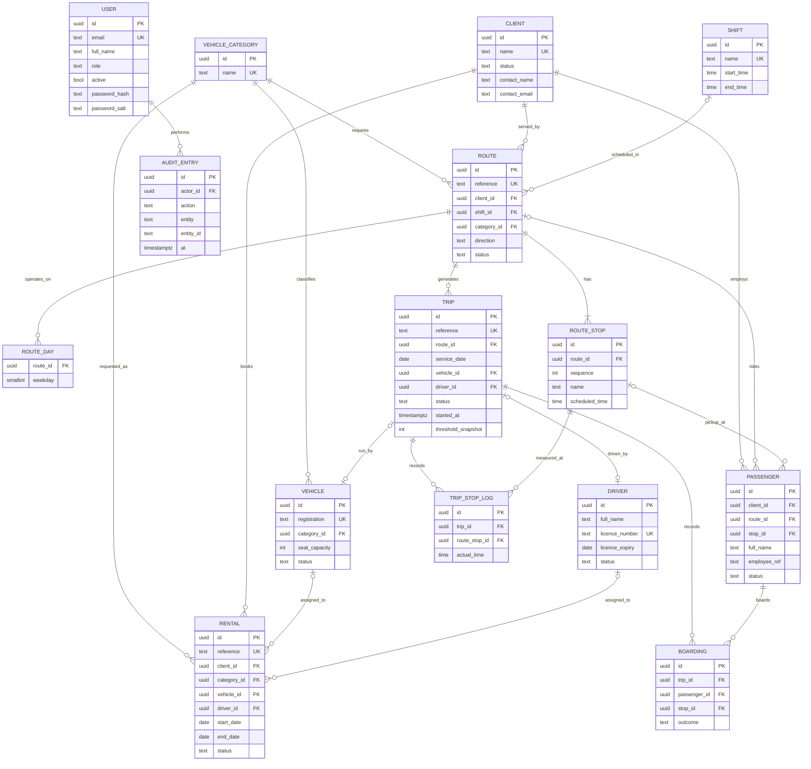
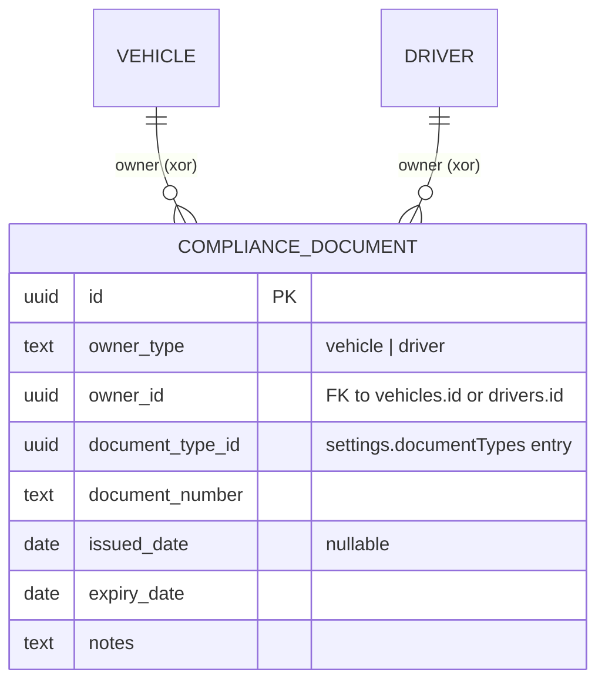
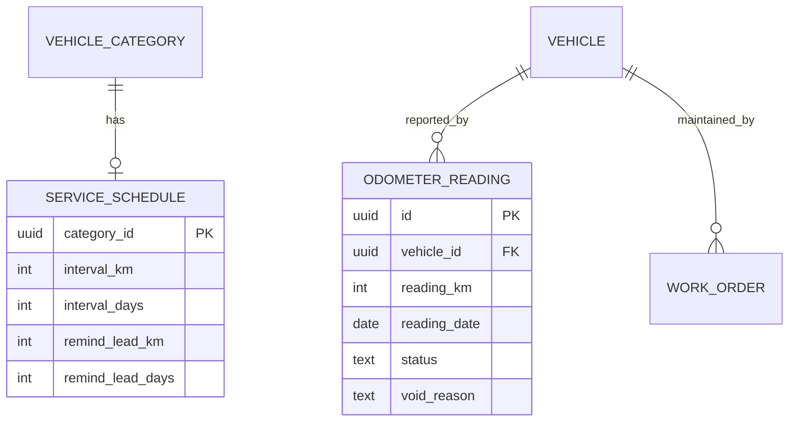
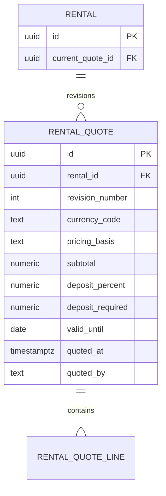

# Entity-relationship model

The app stores these as arrays inside one JSON document (schema version 10). This diagram is the **target relational schema** that a PostgreSQL build would implement. Fields are simplified; `id` columns are UUIDs.



## Key relationships

| Relationship | Rule |
|---|---|
| Route to stops | One route has two or more ordered stops. Stop names are unique within a route. Times never decrease along the route. |
| Route to trips | One trip per route per service date. Trips are generated only on the route's operating weekdays, inside its start and end dates. |
| Passenger to route | A passenger has at most one route and one pickup stop (a limit; see OPEN_QUESTIONS Q-30). The stop must belong to that route, and the route must belong to the passenger's client. |
| Trip to boardings | One boarding record per active roster passenger per completed trip. Inactive passengers are excluded. |
| Trip to vehicle and driver | Set at assignment, required at dispatch. The vehicle must be in the route's category and status Available. The driver's licence must be valid on the service date. |

## Unique constraints

| Table | Constraint |
|---|---|
| USER | `email` unique (normalised lower-case) |
| VEHICLE | `registration` unique after removing spaces and hyphens, upper-cased |
| VEHICLE_CATEGORY, SHIFT | `name` unique (case-insensitive) |
| CLIENT | `name` unique (case-insensitive) |
| DRIVER | `licence_number` unique (upper-cased) |
| RENTAL | `reference` unique |
| ROUTE | `reference` unique |
| ROUTE_STOP | `(route_id, sequence)` unique |
| PASSENGER | `(client_id, employee_ref)` unique where `employee_ref <> ''` |
| TRIP | `(route_id, service_date)` unique; `reference` unique |
| BOARDING | `(trip_id, passenger_id)` unique |

## Indexes

- `TRIP (service_date, status)` for the daily board.
- `TRIP (vehicle_id, service_date)` and `TRIP (driver_id, service_date)` for conflict checks.
- `RENTAL (status, start_date, end_date)` for availability checks.
- `AUDIT_ENTRY (entity, entity_id)` and `AUDIT_ENTRY (at DESC)`.
- `PASSENGER (client_id, status)`.

## Compliance documents



`COMPLIANCE_DOCUMENT.owner_id` is polymorphic (vehicle or driver), so the foreign key is
enforced by the service layer rather than a single SQL FK. There is no `document_type` table
in this build: the catalogue lives in `settings.documentTypes` (id, name, appliesTo: vehicle |
driver | both) and is company-configured with no seeded values (Q-16). A document type in use
by any record cannot be removed. Owner and `document_type_id` are immutable after creation;
`document_number`, `issued_date`, `expiry_date` and `notes` are editable (D-27).

Distinct from `drivers.licence_expiry`, which continues to gate trip and rental assignment.

## Exclusion constraints (no-double-booking)

These need the `btree_gist` extension. They are the database form of the overlap rules that the service enforces in code today. Neither is enforced by the current browser build.

```sql
-- Trip resource overlap: a vehicle or driver cannot run two live trips whose time windows overlap on a day.
-- window_start and window_end are the first and last stop times on the service date.
ALTER TABLE trip ADD CONSTRAINT trip_vehicle_no_overlap
  EXCLUDE USING gist (
    vehicle_id WITH =,
    tsrange(service_date + window_start, service_date + window_end) WITH &&
  ) WHERE (status IN ('planned', 'dispatched', 'in_progress') AND vehicle_id IS NOT NULL);

ALTER TABLE trip ADD CONSTRAINT trip_driver_no_overlap
  EXCLUDE USING gist (
    driver_id WITH =,
    tsrange(service_date + window_start, service_date + window_end) WITH &&
  ) WHERE (status IN ('planned', 'dispatched', 'in_progress') AND driver_id IS NOT NULL);

-- Rental vehicle overlap: whole-day ranges.
ALTER TABLE rental ADD CONSTRAINT rental_vehicle_no_overlap
  EXCLUDE USING gist (
    vehicle_id WITH =,
    daterange(start_date, end_date, '[]') WITH &&
  ) WHERE (status IN ('confirmed', 'in_progress') AND vehicle_id IS NOT NULL);
```

Cross-module clashes (a vehicle on a rental and a trip on the same day) cannot be expressed as one constraint across two tables. The recommended design is a `resource_reservation` table (`resource_id`, `resource_type`, `during tsrange`, `source`) with one exclusion constraint per resource type. Both trips and rentals would write to it.

Note: the Phase 0 brief refers to "section 5.1" for the exclusion constraints. That section is not in the uploaded text. The constraints above are what this build implements and what it would need in PostgreSQL.

## Phase 8 service intervals and odometer readings



- `service_schedule.category_id` is a unique FK to `vehicle_category(id)` with
  `CHECK (interval_km IS NOT NULL OR interval_days IS NOT NULL)`.
- `work_order.resets_service_interval` plus `work_order.completed_at` identify the service anchor
  (`WHERE resets_service_interval AND completed_at IS NOT NULL`).
- Hand-entered readings must never go backwards for a vehicle; in PostgreSQL this needs a
  per-vehicle lock or monotonic check rather than a plain unique constraint.

## Phase 9 expired-quote revisions

The browser schema keeps the current quotation on `rental.quote` and prior immutable snapshots
in `rental.quoteHistory[]`. A relational schema should split this into:



Unique `(rental_id, revision_number)`; quote and line snapshots are immutable. The initial
quote is revision 1; each permitted renewal creates revision N+1 and keeps the previous
snapshot, so the current quote count equals history length + 1.
