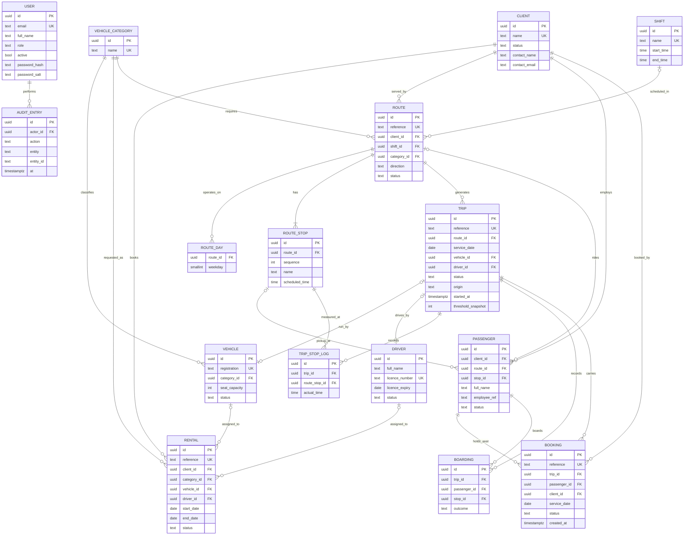
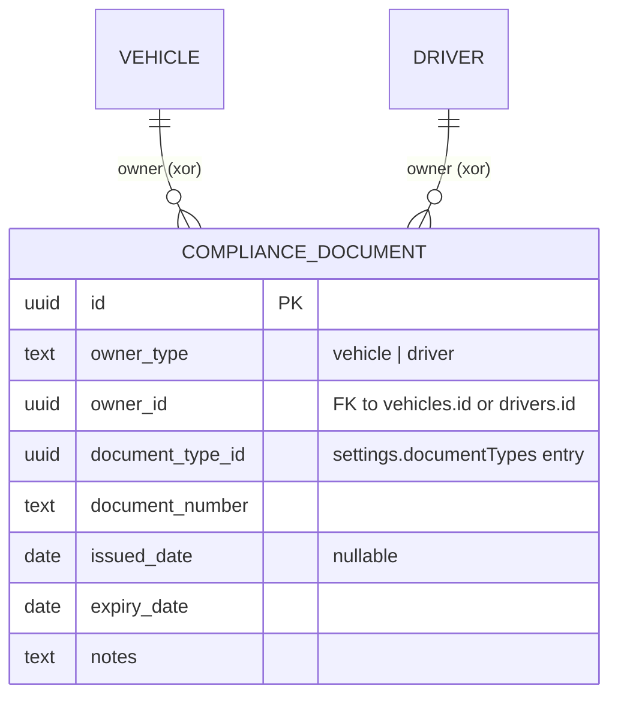
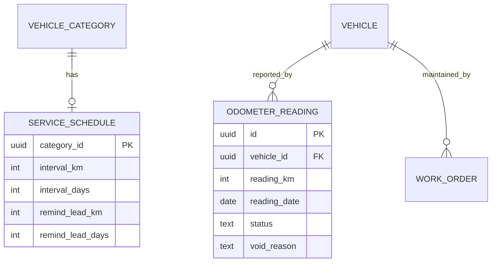
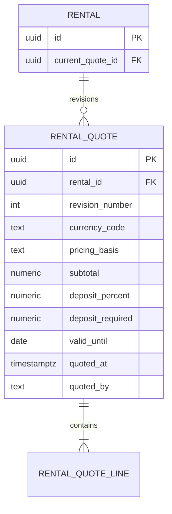
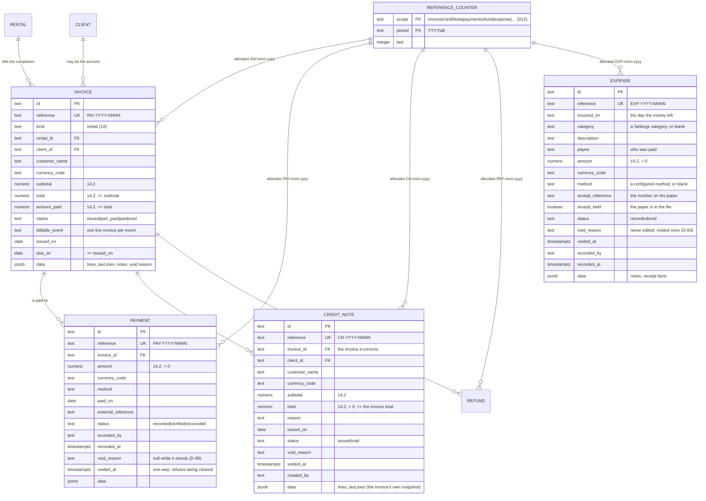

# Entity-relationship model

The app stores these as arrays inside one JSON document (schema version 18). This diagram is the **target relational schema** that a PostgreSQL build would implement. Fields are simplified; `id` columns are UUIDs.



## Key relationships

| Relationship | Rule |
|---|---|
| Route to stops | One route has two or more ordered stops. Stop names are unique within a route. Times never decrease along the route. |
| Route to trips | One **scheduled** trip per route per service date. Scheduled trips are generated only on the route's operating weekdays, inside its start and end dates. An **ad hoc** trip (\`origin = 'adhoc'\`) may exist on any date, including a date the route does not operate, and may sit beside a cancelled scheduled run; it carries a written reason (D-82). |
| Passenger to route | A passenger has at most one route and one pickup stop (a limit; see OPEN_QUESTIONS Q-30). The stop must belong to that route, and the route must belong to the passenger's client. |
| Trip to boardings | One boarding record per rider expected on the trip: every active roster passenger **and** every booking on that run that still holds a seat (`confirmed` or `offered`, D-85). Inactive roster members are excluded; a cancelled or rejected booking is not expected aboard. |
| Trip to bookings | A booking names one rider's seat on one run. It is **not** a roster row: the roster is how a client's staff travel every day, and a booking covers the seat that has to be named — a visitor, a new hire, somebody from a sister company (D-83). Capacity is `vehicle.seat_capacity − active roster on the route − confirmed/offered bookings`, checked in the booking command. |
| Booking to passenger | One live booking per rider per run. A rider who is already on that run's route roster is refused, because the roster already holds their seat. A booking that holds a seat is also a row on the run's manifest, so its rider receives a boarding outcome like any roster rider. |
| Trip to vehicle and driver | Set at assignment, required at dispatch. The vehicle must be in the route's category and status Available. The driver's licence must be valid on the service date. |

## Unique constraints

| Table | Constraint |
|---|---|
| USER | `email` unique (normalised lower-case) |
| VEHICLE | `registration` unique after removing spaces and hyphens, upper-cased |
| VEHICLE_CATEGORY, SHIFT | `name` unique (case-insensitive) |
| CLIENT | `name` unique (case-insensitive) |
| DRIVER | `licence_number` unique (upper-cased) |
| RENTAL | `reference` unique |
| ROUTE | `reference` unique |
| ROUTE_STOP | `(route_id, sequence)` unique |
| PASSENGER | `(client_id, employee_ref)` unique where `employee_ref <> ''` |
| TRIP | `(route_id, service_date)` unique **where `origin = 'schedule'`** (migration 006); `reference` unique; `origin` is one of `schedule`, `adhoc` |
| BOARDING | `(trip_id, passenger_id)` unique |
| BOOKING | `reference` unique; `(trip_id, passenger_id)` unique **where `status in ('requested','confirmed','waitlisted','offered')`** (migration 007), so a refused or cancelled rider may ask for the seat again while a duplicate live seat is impossible |

## Indexes

- `TRIP (service_date, status)` for the daily board.
- `TRIP (vehicle_id, service_date)` and `TRIP (driver_id, service_date)` for conflict checks.
- `RENTAL (status, start_date, end_date)` for availability checks.
- `AUDIT_ENTRY (entity, entity_id)` and `AUDIT_ENTRY (at DESC)`.
- `PASSENGER (client_id, status)`.
- `BOOKING (service_date, status)` for the day's seat view, and `BOOKING (client_id)` for a client contact's own scope.

## Compliance documents



`COMPLIANCE_DOCUMENT.owner_id` is polymorphic (vehicle or driver), so the foreign key is
enforced by the service layer rather than a single SQL FK. There is no `document_type` table
in this build: the catalogue lives in `settings.documentTypes` (id, name, appliesTo: vehicle |
driver | both, required: boolean) and is company-configured with no seeded values (Q-16). A type
with `required: true` refuses assignment while it is missing or lapsed on the day of the work
(D-76). A document type in use by any record cannot be removed. Owner and `document_type_id` are immutable after creation;
`document_number`, `issued_date`, `expiry_date` and `notes` are editable (D-27).

Distinct from `drivers.licence_expiry`, which continues to gate trip and rental assignment.

`settings.maintenance` holds the service intervals (one per vehicle category) and one switch,
`blockOnOverdueService`, which decides whether an overdue routine service refuses work or is only
reported (D-75). It is a setting rather than a column on the vehicle because the rule is the
company's, not the vehicle's; the vehicle's own state is on `VEHICLE.status`, which an incident
changes when a defect takes it off the road.

Two other catalogues live in settings rather than in their own tables: `settings.workTypes` (what a
work order is for) and `settings.costCategories` (what a recorded cost was for). A work order and a
cost entry store the name they were given, so renaming a catalogue entry never rewrites history
(D-78).

`Trip.origin` is a column rather than a value inside the row's JSON because a database constraint has
to read it: migration 006 replaced the whole-table unique index with a partial one, so the rule "one
scheduled run per route per day" survives while an emergency run can still be created (D-82). The
reason for an ad hoc run stays in the row's data, because nothing queries it.

`Booking.history` is embedded on the booking rather than kept in a table of its own: it is written
once with the change it describes, never edited, and read whole beside the booking (BKG-06).

`Trip.corrections` and `Trip.rosterChanges` are embedded on the trip rather than kept in tables of
their own: both are append-only notes about one run (a corrected fact; a rider added, removed or
moved while that run was under way), read with the run and never queried across runs. Each entry
carries its own id, timestamp and author, so the record explains itself without a join (D-73, D-79).

## Exclusion constraints (no-double-booking)

These need the `btree_gist` extension. They are the database form of the overlap rules that the service enforces in code today. Neither is enforced by the current browser build.

```sql
-- Trip resource overlap: a vehicle or driver cannot run two live trips whose time windows overlap on a day.
-- window_start and window_end are the first and last stop times on the service date.
ALTER TABLE trip ADD CONSTRAINT trip_vehicle_no_overlap
  EXCLUDE USING gist (
    vehicle_id WITH =,
    tsrange(service_date + window_start, service_date + window_end) WITH &&
  ) WHERE (status IN ('planned', 'dispatched', 'in_progress') AND vehicle_id IS NOT NULL);

ALTER TABLE trip ADD CONSTRAINT trip_driver_no_overlap
  EXCLUDE USING gist (
    driver_id WITH =,
    tsrange(service_date + window_start, service_date + window_end) WITH &&
  ) WHERE (status IN ('planned', 'dispatched', 'in_progress') AND driver_id IS NOT NULL);

-- Rental vehicle overlap: whole-day ranges.
ALTER TABLE rental ADD CONSTRAINT rental_vehicle_no_overlap
  EXCLUDE USING gist (
    vehicle_id WITH =,
    daterange(start_date, end_date, '[]') WITH &&
  ) WHERE (status IN ('confirmed', 'in_progress') AND vehicle_id IS NOT NULL);
```

Cross-module clashes (a vehicle on a rental and a trip on the same day) cannot be expressed as one constraint across two tables. The recommended design is a `resource_reservation` table (`resource_id`, `resource_type`, `during tsrange`, `source`) with one exclusion constraint per resource type. Both trips and rentals would write to it.

Note: the Phase 0 brief refers to "section 5.1" for the exclusion constraints. That section is not in the uploaded text. The constraints above are what this build implements and what it would need in PostgreSQL.

## Phase 8 service intervals and odometer readings



- `service_schedule.category_id` is a unique FK to `vehicle_category(id)` with
  `CHECK (interval_km IS NOT NULL OR interval_days IS NOT NULL)`.
- `work_order.resets_service_interval` plus `work_order.completed_at` identify the service anchor
  (`WHERE resets_service_interval AND completed_at IS NOT NULL`).
- Hand-entered readings must never go backwards for a vehicle; in PostgreSQL this needs a
  per-vehicle lock or monotonic check rather than a plain unique constraint.

## Phase 9 expired-quote revisions

The browser schema keeps the current quotation on `rental.quote` and prior immutable snapshots
in `rental.quoteHistory[]`. A relational schema should split this into:



Unique `(rental_id, revision_number)`; quote and line snapshots are immutable. The initial
quote is revision 1; each permitted renewal creates revision N+1 and keeps the previous
snapshot, so the current quote count equals history length + 1.

## Phase 16 invoices and payments (implemented in `db/migrations/003_invoices_and_payments.sql`, extended by `008_credit_notes.sql`, `009_payment_cancellations.sql` and `010_refunds.sql`; expenses in `011_expenses.sql`)



Constraints and triggers:

- `invoice_billable_event_uq` — partial unique index on `billable_event` `WHERE status <> 'void'`, so
  a service is billed once but a voided invoice can be replaced.
- `payment_external_reference_uq` — partial unique index on `(invoice_id, external_reference)`
  `WHERE external_reference <> ''`: the idempotency key a retried bank slip needs (brief 5.4, 5.8).
- `invoice_frozen_trg` — refuses any change to reference, kind, rental, client, customer, currency,
  subtotal, total, billable event, dates or the `lines`/`taxLines` JSON, and refuses to void an
  invoice with payments.
- `payment_frozen_trg` — refuses any change to the financial fields, refuses a status move backwards,
  and allows the cancellation pair (`void_reason`, `voided_at`) to be set **once** and never cleared
  (`009_payment_cancellations.sql`, D-88); `payment_void_has_reason` refuses one without the other.
- `invoice_no_delete_trg`, `payment_no_delete_trg` — delete is never allowed (brief 5.9).
- **`credit_note` (migration `008_credit_notes.sql`, D-86).** A credit note is the only way money comes
  off an issued invoice. `credit_note_within_invoice_trg` locks the invoice row and refuses an insert
  whose total would push the sum of live credits past the invoice's own total, so two simultaneous
  credit notes cannot each see the same room; `credit_note_frozen_trg` makes the document immutable and
  refuses to un-void one; `credit_note_no_delete_trg` refuses a delete. `credit_note_void_has_reason`
  is a check constraint, not a courtesy. Note that the ceiling is the invoice total and **not** what is
  still unpaid: crediting an invoice that is already paid is a refund, and `paid + credited − total`
  is reported as a refund due rather than netted away (`src/tms/creditNotes.ts`).
- **`refund` (migration `010_refunds.sql`, D-92).** Money actually paid back. `refund_within_due_trg`
  locks the invoice and refuses an amount greater than `live payments + live credits − invoice total −
  live refunds`, so the same over-credit cannot be paid out twice; `refund_void_has_reason` is a check
  constraint; `refund_frozen_trg` keeps the financial fields immutable and allows the cancellation to be
  set once; `refund_no_delete_trg` refuses a delete. A refund does **not** change `payment`, and the
  invoice's `amount_paid` is untouched by it.
- **`expense` (migration `011_expenses.sql`, D-93).** Money spent that is not a repair. Checks:
  `reference ~ '^EXP-[0-9]{4}-[0-9]{4,}$'`, `amount > 0`, `status in ('recorded','void')`,
  `expense_void_has_reason` (a void carries a reason and a time), `expense_held_has_reference` (the
  paper cannot be held without a number printed on it). `expense_frozen_trg` refuses any change to the
  reference, date, category, description, payee, amount, currency, method, receipt facts or who
  recorded it, makes the void one-way, and requires `voided_at` with the reason; `expense_no_delete_trg`
  refuses a delete. Indexes `expense_incurred_idx` and `expense_category_idx` keep the period and
  category reports cheap. A scanned copy is **not** stored — only the number and whether the paper is
  held (D-93).
- `reference_counter` is written by the same transaction that writes the document, so two writers
  cannot allocate the same number.
